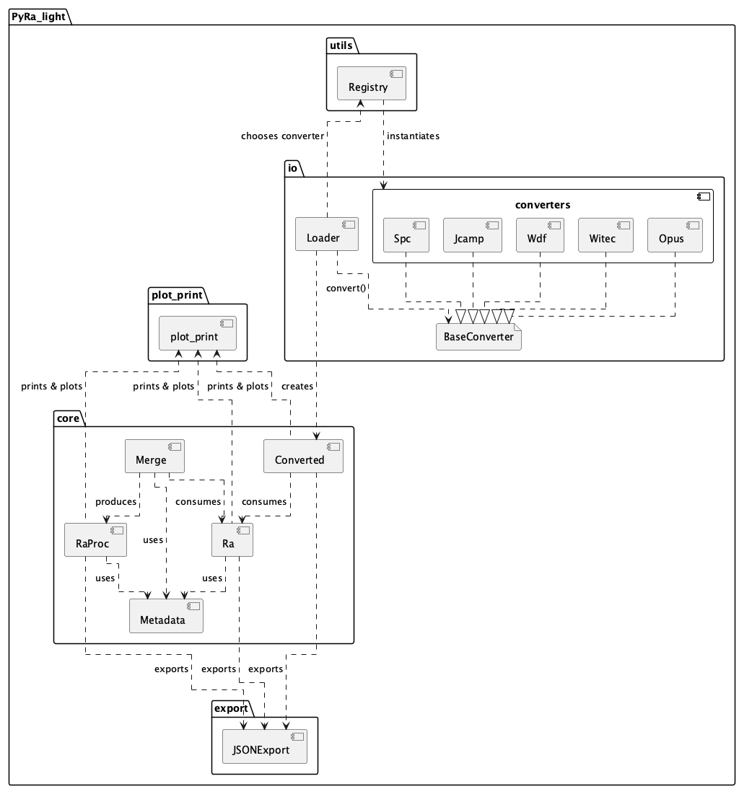
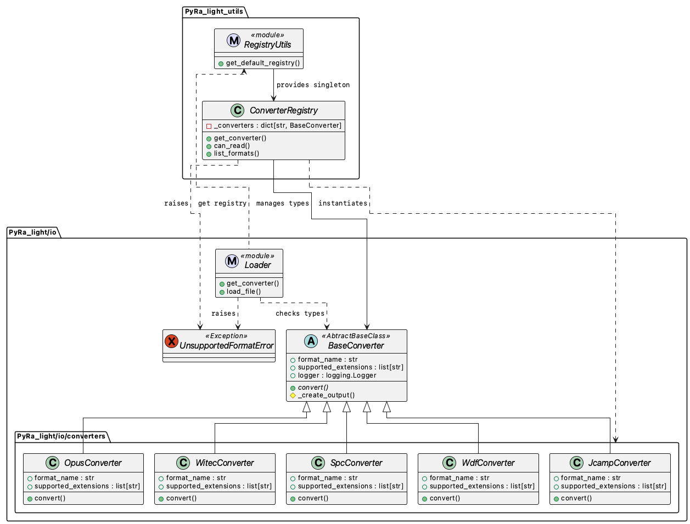
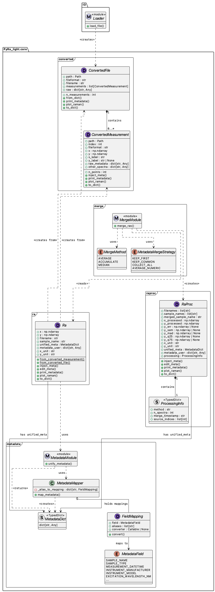
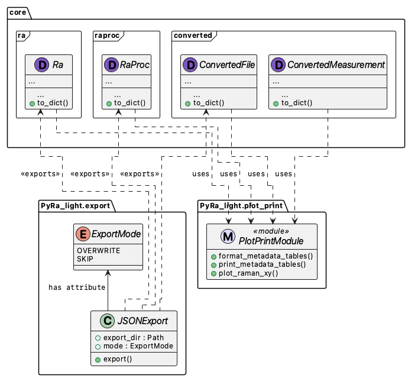

# PyRa_light: lightweight Raman file loading, metadata unification, merging, and export

## Introduction

This package, PyRa_light, grew out of the motivation to build large, reliable Raman datasets for machine learning (see SpecReK), where every spectrum keeps its experimental context (i.e. metadata).

In practice, most Raman spectrometer software offers an export function to write spectra to CSV or TXT. The problem is that during these exports via the vendor-specific software, a large part of the metadata (laser wavelength, integration time, objective, preprocessing flags, etc.) is often lost. This makes data hard to compare across instruments and can make reproducible ML training very difficult. PyRa_light keeps spectra and metadata together by converting vendor files into a unified representation and a stable, standardized metadata schema.

PyRa_light is a small Python package (no UI) that helps you load, convert, inspect, and export Raman spectra from different instrument file formats. It reads the files, cleans up and standardizes the metadata, and provides simple tools to plot, print metadata, and export JSONs.

PyRa_light also supports merging similar spectra (same x/y shape), for example by averaging or accumulation. This was built to simulate the kind of averaging/accumulation normally done while Raman measuring by measuring repeatedly on the same spot. Here the idea is to average accross multiple measurements from different areas/spots to have a kind of area averaging/accumulation.

PyRa_light currently supports Bruker OPUS, SPC, Renishaw WDF, WITec WIP, and JCAMP.

---

## Table of Contents

- [PyRa\_light: lightweight Raman file loading, metadata unification, merging, and export](#pyra_light-lightweight-raman-file-loading-metadata-unification-merging-and-export)
  - [Introduction](#introduction)
  - [Table of Contents](#table-of-contents)
  - [1. Installation](#1-installation)
  - [2. Quick Start](#2-quick-start)
  - [3. Functionalities](#3-functionalities)
    - [3.1 Loading files](#31-loading-files)
    - [3.2 Metadata unification and injection](#32-metadata-unification-and-injection)
    - [3.3. Merging of Spectra](#33-merging-of-spectra)
    - [3.4. Plotting and printing](#34-plotting-and-printing)
    - [3.5. Export](#35-export)
    - [3.6. Logging](#36-logging)
  - [4. Architecture (UML-, Component-, Sequence-diagrams)](#4-architecture-uml--component--sequence-diagrams)
    - [4.1 Packages](#41-packages)
    - [4.2 Class-Structure](#42-class-structure)
      - [4.2.1 File loading and converters](#421-file-loading-and-converters)
      - [4.2.2 Core structure](#422-core-structure)
      - [4.2.3 Export, plotting, and printing](#423-export-plotting-and-printing)
    - [4.3 Important Methods](#43-important-methods)
      - [4.3.1 IO-level](#431-io-level)
      - [4.3.2 ConvertedFile](#432-convertedfile)
      - [4.3.3 Ra](#433-ra)
      - [4.3.4 RaProc](#434-raproc)
      - [4.3.5 Export](#435-export)
  - [5. Testing](#5-testing)
  - [6. Future Updates](#6-future-updates)


---

## 1. Installation

```bash
pip install "https://github.com/Schubert-group-Digital-Automatization/PyRa_light.git"
```

After installation, the library is imported as `PyRa_light`.

Some file formats rely on external reader libraries (for example OPUS, WDF, WIP). If you use those formats, make sure the corresponding reader dependency is installed in your environment (should be done during installation).

**Warning**: ***Some of the dependencies seem not well-maintained!***

---

## 2. Quick Start

```python
from PyRa_light import load_file, Ra, merge_ras

# Load any supported file and convert it to a ConvertedFile-instance
cf = load_file("/path/to/spectrum.opus")

# Plot. If there are more meaurments in a ConvertedFile, they are superimposed.
cf.plot_raman()

# Convert ConvertedFile to unified Ra objects (one Ra per ConvertedMeasurement)
ras = Ra.from_converted_file(cf)

# Plot the first Ra-object
ras[0].plot_raman()

# Merge replicates (average / median / accumulate)
rp = merge_ras(ras, method="average")

# Plot merged spectrum with an uncertainty band (y_err, y_sem, y_mad; iqr)
rp.plot_raman(band="y_err")
```

---

## 3. Functionalities

PyRa_light is structured around three object layers.

`ConvertedFile` and `ConvertedMeasurement` form the standardized IO layer. They represent a source file and its contained measurement(s) after conversion, including the raw vendor metadata and any additional spectral blocks a format may expose. For example, Bruker OPUS files typically contain a single measurement with multiple spectral blocks, whereas WITec WIP files may contain multiple measurements per file but usually only one spectral block per measurement.

`Ra` provides the unified (harmonized) spectrum layer. Each `Ra` instance represents one Raman spectrum (`x`/`y` arrays) together with metadata that have been mapped into a predefined, canonical schema.

`RaProc` provides the processed spectrum layer (currently focused on merging). It represents the result of combining multiple `Ra` spectra and therefore stores the merged `x`/`y` arrays as well as optional dispersion measures (for example standard deviation, SEM, MAD, or quartiles), depending on the selected merge method. Metadata are merged alongside the spectra.

<br>

### 3.1 Loading files

The main entry point is `load_file(path)`. A converter is selected from the registry based on the file suffix, the conversion is executed, and the result is returned as a `ConvertedFile`.

```python
from PyRa_light import load_file

cf = load_file("sample.wdf")
print(cf.fileformat, cf.n_measurements)
```

Each concrete converter is implemented for a corresponding vendor format (and depend on the specific package) and returns a standardized conversion dictionary. This dictionary is wrapped into the `ConvertedFile` / `ConvertedMeasurement` transport objects, so downstream code can rely on a consistent in-memory structure independent of the original format.

<br>

### 3.2 Metadata unification and injection

Vendor metadata are typically heterogeneous across manufacturers (naming, units, conventions). A predefined metadata schema is therefore applied during unification.

Metadata are stored in two separate dictionaries on the unified objects (`Ra`, and similarly `RaProc`).

- `unified_meta`: standardized metadata produced by mapping the raw metadata of a `ConvertedMeasurement` into canonical field names.
- `metadata_user`: free-form metadata that are not part of the canonical schema and may be populated manually (for example project tags, sample IDs, notes, labels, or annotations).

During construction, `Ra` performs metadata unification. After this step, `ra.unified_meta` exposes stable, predefined field names independent of the originating file format.

Manual updates are supported through two methods.

- `inject_meta({key: value}, overwrite=False)` adds metadata from a dictionary. With `overwrite=False` (default), keys are written to `metadata_user`. With `overwrite=True`, keys are written to `unified_meta` and may replace existing canonical values.
- `edit_meta(...)` provides the same operation for canonical fields via keyword arguments. Only known canonical field names are accepted, and existing values may be protected with `overwrite=False`.

Note: metadata injection is also supported on `ConvertedMeasurement` via `inject_meta()`.

```python
from PyRa_light import load_file, Ra

# Load a vendor file (OPUS/SPC/WDF/WIP/JCAMP) into a ConvertedFile
cf = load_file("/path/to/spectrum.opus")

# Build unified Raman objects (one Ra per measurement)
ras = Ra.from_converted_file(cf)
ra = ras[0]

# Add free-form metadata (stored in metadata_user)
ra.inject_meta({"project": "SpecReK", "sample_id": "Sample01", "hello": "world"})

# Set/overwrite canonical fields (stored in unified_meta)
ra.inject_meta({"laser_wavelength_nm": 532.0, "integration_time_s": 1.0}, overwrite=True)

# Edit canonical fields via keyword arguments
ra.edit_meta(sample_name="Sample001", sample_type="PE", overwrite=True)
```

<br>

### 3.3. Merging of Spectra

`merge_ras()` combines multiple `Ra` objects on a shared x-grid. Supported merge methods include `average`, `median`, and `accumulate`.

- `average` produces a mean spectrum and the error statistics: standard deviation: `y_err`, standard error of the mean: `y_sem`, and 25, 75% quartiles: `iqr`.
- `median` produces a median spectrum and the error statistics; standard deviation: `y_err`, mean absolute deviation: `y_mad` and 25, 75% quartiles: `iqr`.
- `accumulate` produces a summed spectrum without error arrays.

```python
from PyRa_light import merge_ras

rp = merge_ras(ras, method="median")
```

Merged metadata is computed with explicit merge rules for key fields (for example averaging numeric acquisition parameters or collecting timestamps) and a keep-common policy for string-based instrument configuration fields.
Here couple of metadata fields might require attention if those values are lost during merging (here we can use `.print_metadata()` to inspect them and then `.edit_meta()` to update).

<br>

### 3.4. Plotting and printing

Plotting and metadata printing are intentionally lightweight in PyRa_light and is meant for quality assurance/checking before exporting.

`ConvertedMeasurement.plot_raman()` plots one measurement. `ConvertedFile.plot_raman(index=None)` overlays all measurements by default or plots a single measurement when an index is given. `Ra.plot_raman()` plots one unified spectrum. `RaProc.plot_raman(band=...)` plots a processed spectrum and can show an uncertainty band such as `y_err` or `iqr`.

For quick inspection of metadata, `.print_metadata()` exists for `ConvertedFile`, `ConvertedMeasurement`, `Ra`, and `RaProc` and prints the metadata_table as tabulate into the terminal.

```python
from PyRa_light import load_file, Ra, merge_ras

# Load a file and inspect the raw conversion output
cf = load_file("/path/to/spectrum.opus")
cf.print_metadata()      # file-level + measurement-level metadata tables
cf.plot_raman()          # overlay all measurements in that file
cf.plot_raman(index=1)   # plot a single measurement by index

# Inspect one ConvertedMeasurement directly
m = cf.measurements[0]
m.print_metadata()
m.plot_raman()

# Ra objects
ras = Ra.from_converted_file(cf)
ra = ras[0]
ra.print_metadata()
ra.plot_raman()

# RaProc objects
rp = merge_ras(ras, method="average")
rp.print_metadata()
rp.plot_raman(band="y_err")   # std band (y ± y_err)
rp.plot_raman(band="iqr")     # quartile band (y_q25..y_q75)
```

<br>

### 3.5. Export

PyRa_light includes two small exporters: a JSON exporter and a lightweight CSV exporter.

The main JSON entry point is `JSONExport.export(...)`. Exporting always targets an output folder. Each call writes exactly one JSON file depending on the object type, and the exporter simply calls `.to_dict()` on the objects.

Filename rules follow a simple stem scheme: `ConvertedFile` is written as `<filename_stem>_conv.json`, `ConvertedMeasurement` as `<sourcefile_stem>_<index>_conv.json`, `Ra` as `<filename_stem>_<index>_ra.json` (or `<filename_stem>_ra.json` as fallback if `index` is `None`), and `RaProc` as `<merged_sample_name>_<avg|med|acc|proc>.json`. If `suffix` is provided, it is appended as `_{suffix}` to the stem before adding `.json`.


```python
from PyRa_light import JSONExport

exporter = JSONExport(export_dir="export_out")

# Export one object per call (writes exactly one JSON file)
exporter.export(cf)                   # ConvertedFile (single JSON containing all measurements)
exporter.export(cf.measurements[0])   # ConvertedMeasurement
exporter.export(ra, suffix="servus!") # Single Ra
exporter.export(rp)                   # RaProc
```


In addition, `CSVExport` provides a three-file CSV bundle export for unified `Ra` objects. Each call writes exactly three files with stem `<filename_stem>_<index>` (and optional `_{suffix}`), and then appends `_x.csv`, `_y.csv`, and `_meta.csv`. The `*_x.csv` and `*_y.csv` files are wide and contain a single row where the first cell is the label (`x` or `y`) followed by all values. The `*_meta.csv` file is a one-row wide table where each canonical metadata key becomes a column; values are stringified for CSV output. The CSV delimiter is `;`. At the moment, the three-CSV export intentionally supports only `Ra` (processed `RaProc` results should be exported as JSON).

```python
from PyRa_light import CSVExport

exporter = CSVExport(export_dir="export_out")

# Export one Ra per call (writes three CSV files)
exporter.export(ra)
exporter.export(ra, suffix="servus!")
```

<br>

### 3.6. Logging

PyRa_light uses the standard Python `logging` module. The loader emits simple `INFO` messages and `DEBUG` messages for converter selection and conversion steps.

In the script logging can be configured as follows:

```python
import logging

logging.basicConfig(level=logging.INFO)
```

<br>

---

## 4. Architecture (UML-, Component-, Sequence-diagrams)

### 4.1 Packages

PyRa_light is split in 4 main packages: in `io` which deals with reading and converting the files `core` which contains the unification and merging logic of `Ra` and `RaProc` as well as `plot_print` which contains the plotting and printing logic.




<br>

### 4.2 Class-Structure

#### 4.2.1 File loading and converters

<br>

The file-loading subsystem consists of the `Loader` module, the `ConverterRegistry`, and the concrete `BaseConverter` implementations. `Loader.load_file()` (together with `get_converter()`) coordinates the process: a converter is resolved for the given path and the standardized output (`ConvertedFile`) is assembled from the conversion dictionary returned by the converter. Converter selection is is delegated to the registry.

The `ConverterRegistry` functions as the dispatch. It maintains the mapping from supported formats (extensions) to converter instances and exposes `get_converter()`, `can_read()`, and `list_formats()`. Compatibility is determined by the file suffix. If no converter matches, an `UnsupportedFormatError` is raised.

Concrete converters are implemented in `PyRa_light.io.converters` and inherit from `BaseConverter`. The base class defines the shared interface (`format_name`, `supported_extensions`, `convert(file_path)`) and enforces a uniform conversion dictionary across vendor formats. This output is then wrapped into `ConvertedFile` and `ConvertedMeasurement` objects.

#### 4.2.2 Core structure

<br>

The core pipeline follows three layers: the conversion transport layer (`Converted*`), the unified spectrum layer (`Ra`), and the processed/merged layer (`RaProc`). 

`ConvertedFile` represents a single source file and aggregates one or more `ConvertedMeasurement` instances. Each `ConvertedMeasurement` contains a spectrum block (`x`, `y`) together with raw vendor metadata (`raw_metadata`) and optional additional spectral blocks (`other_spectra`, as some files provide them). At this stage, the representation is intentionally lossless: the original metadata structure is retained and no schema assumptions are applied.

`Ra` is constructed from (a list of) `ConvertedMeasurement` (via `from_converted_measurement()` or `from_converted_file()`) and represents the normalized object used throughout the core logic. 
Arrays and units are carried over, while metadata are split into `unified_meta` (predefined, canonical keys) and `metadata_user` (free-form additions). Canonical mapping is performed by the metadata subsystem: `MetadataModule.unify_metadata()` delegates to `MetadataMapper.map_metadata()`, which applies `FieldMapping` rules. Each `FieldMapping` associates one canonical `MetadataField` with a set of vendor aliases and an optional converter, producing stable key/value pairs independent of the originating file format.

Spectral aggregation (accumulation / averaging) is implemented in `core.merge` and produces a `RaProc` instance. `MergeModule.merge_ras()` consumes a list of `Ra` objects, (they need a matching x-array-shape), and computes `x_processed` and `y_processed`. Depending on the selected `MergeMethod`, additional error arrays are calculated and attached (e.g., `y_err`, `y_sem`, `y_mad`, or `iqr`(25%, 75% quartile)). Metadata of the individual `ra`objects are merged using explicit `MetadataMergeStrategy` rules and stored again as `unified_meta` and `metadata_user`. The maerging/processing parameters are stored in `processing` (`ProcessingInfo`).

#### 4.2.3 Export, plotting, and printing

<br>

Plotting and metadata printing lives in `PyRa_light.plot_print` (for example `plot_raman_xy(...)` and the metadata table helpers). The core data classes (`ConvertedFile`, `ConvertedMeasurement`, `Ra`, `RaProc`) provide (`plot_raman()`, `print_metadata()`) that prepare arrays and metadata and delegate rendering/formatting to `plot_print`. This keeps visualization orthogonal to the data model and is mainly meant for inspection and debugging.

Export is implemented in `PyRa_light.export`. The `JSONExport` class writes `ConvertedFile`, `ConvertedMeasurement`, `Ra`, and `RaProc` objects to JSON (main entry point: `JSONExport.export(...)`).

<br>

### 4.3 Important Methods

The methods below form the main entry points which should be used.

#### 4.3.1 IO-level

- **`load_file(path : str | Path) -> ConvertedFile`**  
  Loads a supported vendor file and returns a standardized `ConvertedFile` container.
  + **path: *str | Path***: input file path.

- **`ConverterRegistry.get_converter(path : str | Path) -> BaseConverter`**  
  Resolves the concrete converter instance for a file path based on suffix/compatibility.
  + **path: *str | Path***: input file path.

<br>

#### 4.3.2 ConvertedFile

- **`ConvertedFile.plot_raman(index : int | None = None, ax = None, show : bool = True, title : str | None = None)`**  
  Plots Raman spectra contained in a `ConvertedFile`. If `index` is `None`, all measurements are overlaid.
  + **index: *int | None***: measurement index to plot; `None` overlays all.
  + **ax: *matplotlib.axes.Axes | None***: target axes; created if `None`.
  + **show: *bool***: show the figure.
  + **title: *str | None***: optional plot title.

- **`ConvertedMeasurement.plot_raman(ax = None, show : bool = True, title : str | None = None)`**  
  Plots a single converted measurement.

- **`ConvertedFile.print_metadata(tablefmt : str = "github", return_str : bool = False)`**  
  Prints (or returns) formatted metadata tables for file-level and measurement-level metadata.
  + **tablefmt: *str***: tabulate output format.
  + **return_str: *bool***: return the formatted string instead of printing.

<br>

#### 4.3.3 Ra

- **`Ra.from_converted_file(converted : ConvertedFile) -> list[Ra]`**  
  Builds unified `Ra` objects from a `ConvertedFile` (one `Ra` per `ConvertedMeasurement`).
  + **converted: *ConvertedFile***: converted source container.

- **`Ra.inject_meta(meta : dict, overwrite : bool = False)`**  
  Injects metadata into a unified object. With `overwrite=False`, keys are added to `metadata_user`; with `overwrite=True`, keys are written into `unified_meta`.
  + **meta: *dict***: metadata key/value pairs.
  + **overwrite: *bool***: write into canonical metadata (`unified_meta`) if `True`.

- **`Ra.edit_meta(overwrite : bool = True, **kwargs)`**  
  Edits canonical metadata fields via keyword arguments. Only known canonical field names are accepted.
  + **overwrite: *bool***: replace existing canonical values if `True`.

<br>

#### 4.3.4 RaProc

- **`merge_ras(ras : list[Ra], method : str = "average", validate_x_grid : bool = True) -> RaProc`**  
  Merges multiple `Ra` spectra on a shared x-grid and returns a processed `RaProc` object.
  + **ras: *list[Ra]***: input spectra.
  + **method: *str***: `"average"`, `"median"`, or `"accumulate"`.
  + **validate_x_grid: *bool***: ensure all spectra share the exact same x-axis.

- **`RaProc.plot_raman(ax = None, show : bool = True, title : str | None = None, band : str | None = None, band_alpha : float = 0.2)`**  
  Plots a merged spectrum; optional uncertainty/dispersion bands may be rendered if present.
  + **band: *str | None***: `"y_err"`, `"y_sem"`, `"y_mad"`, or `"iqr"`.
  + **band_alpha: *float***: transparency (`0.0` to `1.0`) for the error band.

<br>

#### 4.3.5 Export


- **`JSONExport(export_dir : Path, mode : ExportMode = ExportMode.OVERWRITE)`**  
  Sets up the exporter.  
  + **export_dir: *Path***: output folder where JSON files are written (created if missing).  
  + **mode: *ExportMode***: what to do if the target file already exists (`OVERWRITE` or `SKIP`).  

- **`JSONExport.export(obj, output_dir : str | Path | None = None, *, suffix : str | None = None) -> Path | None`**  
  Exports exactly one object into exactly one JSON file.  
  + **obj: *ConvertedFile | ConvertedMeasurement | Ra | RaProc***: object to export.  
  + **output_dir: *str | Path | None***: optional output folder override (defaults to `export_dir`). Must be a directory.  
  + **suffix: *str | None***: optional free-form suffix appended as `_{suffix}` to the filename stem.  
  + **returns**: path of the written file, or `None` if `mode=SKIP` and the file exists.

- **`CSVExport(export_dir : Path, mode : ExportMode = ExportMode.OVERWRITE)`**  
  Sets up the CSV exporter. It writes a three-file CSV bundle for unified `Ra` objects.  
  + **export_dir: *Path***: output folder where CSV files are written (created if missing).  
  + **mode: *ExportMode***: what to do if any target file already exists (`OVERWRITE` or `SKIP`).  

- **`CSVExport.export(ra : Ra, output_dir : str | Path | None = None, *, suffix : str | None = None) -> tuple[Path, Path, Path] | None`**  
  Exports exactly one `Ra` object into exactly three CSV files (`*_x.csv`, `*_y.csv`, `*_meta.csv`). The stem is `<filename_stem>_<index>` (plus optional `_{suffix}`) before adding `_x/_y/_meta`.  
  + **ra: *Ra***: unified spectrum to export.  
  + **output_dir: *str | Path | None***: optional output folder override (defaults to `export_dir`). Must be a directory.  
  + **suffix: *str | None***: optional free-form suffix appended as `_{suffix}` to the filename stem before adding `_x/_y/_meta`.  
  + **returns**: `(x_csv, y_csv, meta_csv)` paths, or `None` if `mode=SKIP` and any target exists.

## 5. Testing

PyRa_light ships with a small pytest suite.

Unit tests live in `test/unit_test/` and focus on single modules/classes.
Integration tests live in `test/integration_tests/` and run the full pipeline on real example files in `test/integration_tests/data/`.

Run unit tests:

```bash
pytest -m "not integration"
```

Run integration tests:

```bash
pytest -m integration
```

Run all:

```bash
pytest
```

## 6. Future Updates

Also further processing like normalization, baseline-correction and peak-picking might be added in the future. However here we have to rework a bit the pipeline....and as the current project does not require this functionality this might be added in the far future (aka when I find some time)